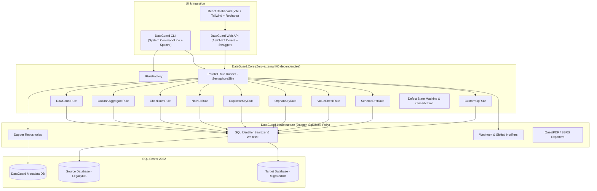
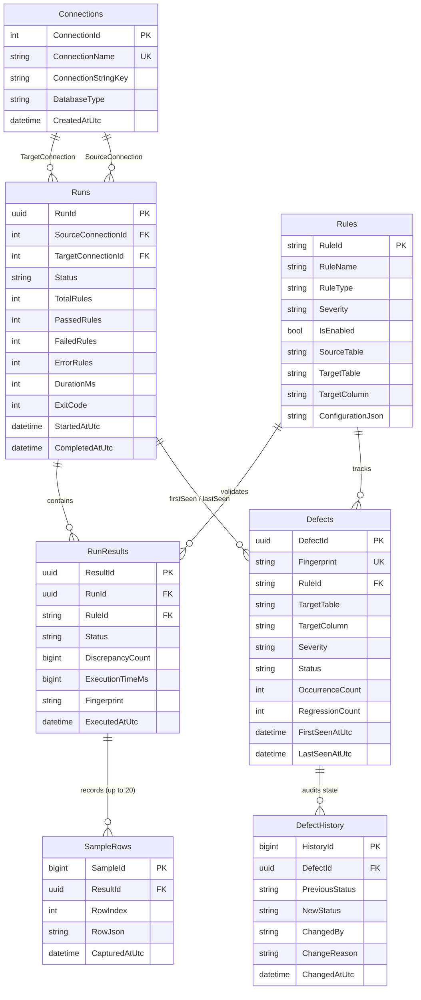

# DataGuard

> **"Prove a data migration is correct, automatically, and track every defect until it's fixed."**

An automated data validation and migration-check tool built specifically for Microsoft SQL Server. DataGuard executes user-defined rule suites across source and target databases, records pass/fail metrics with sample bad rows, classifies discrepancies run-over-run (*New*, *Recurring*, *Fixed*), manages de-duplicated defect lifecycles, notifies Slack/Teams & GitHub, and gates CI/CD pipelines via deterministic CLI exit codes.

---

## Key Features

- **9 High-Performance SQL Server Validation Rules**: Row count, column aggregate comparisons (`SUM`, `MIN`, `MAX`, `AVG`), `CHECKSUM_AGG`/`HASHBYTES` row hashing, mandatory NOT NULL/blank checks, candidate/composite key uniqueness, orphan foreign key integrity, domain/range/pattern validation, schema drift inspection, and sandboxed custom SELECT queries.
- **Dynamic SQL Injection Immunity**: Strict two-phase sanitization using `INFORMATION_SCHEMA` whitelisting, `QUOTENAME()`, and parameterized execution via `sp_executesql`.
- **Run-Over-Run Defect Intelligence**: SHA-256 defect fingerprinting (`RuleId + Table + Column`), automatic defect closure on pass, regression detection on re-failure, and audit triggers.
- **Multi-Channel Integrations**: Slack/Microsoft Teams webhooks with Polly exponential backoff and GitHub Issues tracking.
- **CI-Ready CLI**: Powered by `System.CommandLine` and `Spectre.Console` with support for console tables, JSON, and JUnit XML outputs.
- **Real-Time Analytics Dashboard**: React + TypeScript + Vite + Tailwind + Recharts dashboard with run drill-down and sample bad row viewer.
- **Dual Reporting**: Enterprise SSRS `.rdl` Data Quality Summary report + code-first PDF exports via QuestPDF.

---

## Architecture & System Design



---

## Entity Relationship Diagram (DataGuard Metadata DB)



---

## Validation Rule Reference

| Rule Type | Strategy Description | Key Parameters | Example Use Case |
| :--- | :--- | :--- | :--- |
| `RowCount` | Compares total or filtered row count between Source and Target tables. | `sourceTable`, `targetTable`, `tolerancePercent`, `filterCondition` | Ensure no records were dropped during ETL. |
| `ColumnAggregate` | Compares `SUM`, `MIN`, `MAX`, or `AVG` on target column with numeric tolerance. | `sourceTable`, `targetTable`, `targetColumn`, `aggregateFunction`, `tolerance` | Validate financial reconciliation and invoice totals. |
| `Checksum` | Calculates `CHECKSUM_AGG(BINARY_CHECKSUM(...))` over column tuples. | `sourceTable`, `targetTable`, `columns`, `filterCondition` | Detect in-row silent corruption across wide tables. |
| `NotNull` | Identifies forbidden NULLs or empty/whitespace strings in mandatory columns. | `targetTable`, `columns`, `allowBlank` | Confirm data cleansing rules on required fields. |
| `DuplicateKey` | Verifies candidate or composite key uniqueness (`HAVING COUNT(*) > 1`). | `targetTable`, `keyColumns`, `filterCondition` | Pre-validate uniqueness before applying primary keys. |
| `OrphanKey` | Identifies child foreign keys lacking corresponding parent records. | `childTable`, `childColumn`, `parentTable`, `parentColumn` | Validate referential integrity across migrated tables. |
| `ValueCheck` | Validates values against allowed sets, min/max ranges, or `LIKE`/`PATINDEX`. | `targetTable`, `targetColumn`, `allowedValues`, `minValue`, `maxValue`, `pattern` | Ensure status codes, categories, and ranges conform. |
| `SchemaDrift` | Validates column existence, data type, length, precision, scale, and nullability. | `sourceTable`, `targetTable` | Detect unwanted schema alterations between DBs. |
| `CustomSql` | Executes user-defined read-only queries expected to return 0 rows. | `customSql`, `expectedCount`, `timeoutSeconds` | Verify complex multi-table domain business invariants. |

---

## Quickstart

### 1. Spin up SQL Server & Seed Databases
```bash
docker compose up -d
```

### 2. Validate Rule Configuration Syntax
```bash
dotnet run --project src/DataGuard.Cli/DataGuard.Cli.csproj -- validate-rules --file rules.sample.json
```

### 3. Run Verification Pipeline
```bash
dotnet run --project src/DataGuard.Cli/DataGuard.Cli.csproj -- run \
  --rules rules.sample.json \
  --source "Server=localhost;Database=LegacyDB;TrustServerCertificate=True;" \
  --target "Server=localhost;Database=MigratedDB;TrustServerCertificate=True;" \
  --format table \
  --parallelism 4
```

### 4. Launch React Dashboard & API
```bash
# Terminal 1: Backend API
dotnet run --project src/DataGuard.Api/DataGuard.Api.csproj

# Terminal 2: Web Dashboard
cd web
npm install
npm run dev
```
Open `http://localhost:5173` to explore the dashboard.

---

## CLI Options & Exit Codes

### CLI Command Syntax
```bash
dataguard run --rules <path|db> --source <conn> --target <conn> [--fail-on <severity>] [--format table|json|junit] [--parallelism N] [--notify] [--webhook-url <url>]
dataguard validate-rules --file <path>
dataguard verify-seed --manifest <path> --rules <path> --source <conn> --target <conn>
```

### Exit Code Contract
| Exit Code | Meaning | Action in CI Pipeline |
| :---: | :--- | :--- |
| `0` | **Success**: All rules passed or failures are below threshold. | Pipeline continues. |
| `1` | **Validation Failure**: One or more rules failed at or above threshold severity. | Pipeline fails and gates deployment. |
| `2` | **Configuration Error**: Missing arguments, invalid JSON schema, or malformed rule definition. | Pipeline fails due to test setup error. |
| `3` | **Database Connection Error**: SQL Server unreachable or authentication failed. | Pipeline fails due to environment outage. |

---

## Design Decisions & Trade-Offs (ADRs)

1. **Direct T-SQL & Dapper over EF Core**: High-throughput validation across 100k+ to 10M+ rows requires zero ORM overhead, exact query plan tuning, and full access to window functions (`LAG`, `ROW_NUMBER`) and `CHECKSUM_AGG`.
2. **Pure Core Library Isolation**: `DataGuard.Core` has zero dependencies on `Microsoft.Data.SqlClient`, ASP.NET, or HTTP. All I/O is cleanly inverted via `ISqlExecutor`, `IRuleRepository`, `IRunRepository`, and `INotifier`.
3. **Strict Dynamic SQL Whitelisting**: Never concatenates user identifiers or filter values. All table/column names are validated against `INFORMATION_SCHEMA`, quoted via `QUOTENAME()`, and parameterized via `sp_executesql`.
4. **Deterministic SHA-256 Defect Fingerprints**: Uniquely tracks defects across runs without duplication. Passing rules automatically resolve active defects; recurring failures track regressions.

---

## Limitations & Future Work

- **Current Prototype Scope**: Built and validated against Microsoft SQL Server 2022.
- **Database Engine Support**: Designed with extensibility for PostgreSQL and Snowflake in future releases.
- **Report Generation**: QuestPDF fallback is provided for PDF exports; full SSRS server deployment requires an active SQL Server Reporting Services instance.
