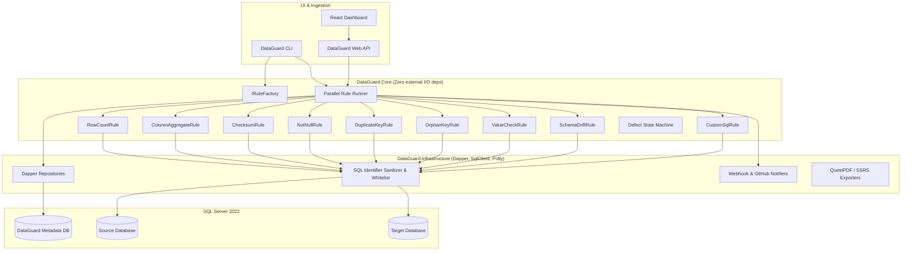

# DataGuard Architecture & Design

## 1. System Overview
**DataGuard** is a high-assurance data validation and migration-verification engine built specifically for Microsoft SQL Server. It enables automated, parallelized correctness checks between source and target datasets (e.g. legacy ERP/CRM vs modernized cloud schemas) while recording granular defect lifecycles run-over-run.

## 2. Layering Principles
1. **`DataGuard.Core`**: Contains domain entities, validation rule interfaces (`IValidationRule`), rule execution contracts (`RuleContext`, `RuleResult`), rule factory (`IRuleFactory`), defect fingerprinting and state transition logic. **Pure C# .NET 8, no SqlClient, HTTP, or Web framework dependencies.**
2. **`DataGuard.Infrastructure`**: Implements Dapper repositories (`IRunRepository`, `IRuleRepository`, `IDefectRepository`), dynamic T-SQL executors with `sp_executesql`, database identifier sanitizers, webhook/GitHub notifiers with Polly resilience policies, and QuestPDF report generation.
3. **`DataGuard.Api`**: ASP.NET Core Web API with versioned `/api/v1` routes, ProblemDetails error contracts, Swagger documentation, background channel hosted worker, and scoped dependency injection.
4. **`DataGuard.Cli`**: High-performance console tool built with `System.CommandLine` and `Spectre.Console`, supporting tabular, JSON, and JUnit XML outputs with strict CI exit codes.
5. **`web`**: React 18 + TypeScript + Vite + Tailwind dashboard with Recharts visualizations.

## 3. Dynamic SQL & Injection Defense
DataGuard never concatenates user-supplied identifiers or raw values into SQL execution strings:
- Schema, table, and column names are validated against `INFORMATION_SCHEMA.COLUMNS` / `sys.columns` whitelist caches.
- Identifiers are wrapped with SQL Server `QUOTENAME()`.
- Filter values, tolerances, and rule parameters are passed exclusively as parameterized arguments via `sp_executesql` and `SqlCommand.Parameters`.

## 4. Defect Tracking & Run-over-Run Classification
Defects are uniquely fingerprinted using a SHA-256 hash calculated over:
$$\text{Fingerprint} = \text{SHA2\_256}(\text{RuleId} + \text{TargetTable} + \text{TargetColumn})$$

- **New**: Failed in the current run, no previous active or closed defect existed.
- **Recurring**: Failed in the current run and was already open in the immediately preceding run.
- **Fixed / Resolved**: Passed in the current run, automatically marking any open defect for this fingerprint as `Resolved`.
- **Reopened**: Failed in the current run after being previously marked `Resolved`, incrementing `RegressionCount`.
